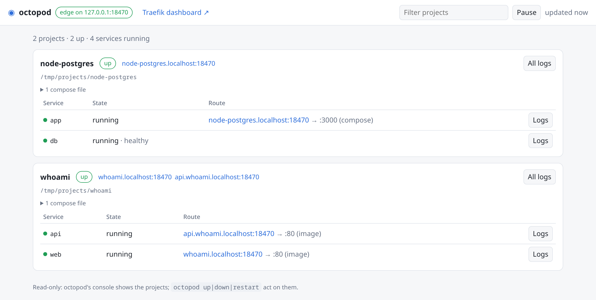

# octopod

[](https://www.npmjs.com/package/@quazardous/octopod)
[](https://github.com/quazardous/octopod/actions/workflows/ci.yml)
[](./LICENSE)
[](https://nodejs.org)

> One local edge for all your Docker projects: a shared Traefik, declared projects and isolated networks — behind a small API.

On a development machine, every Docker project grows its own Traefik, its own labels, its
own ports. They fight over port 80, one Traefik adopts another project's routes, and each
project repeats the same traps in its own compose file. octopod does that part once, for
the whole machine.

- **One edge for every project.** A single Traefik on loopback serves each project at
  `http://<project>.octopod.localhost` (and `http://<name>.<project>.octopod.localhost`). No DNS, no
  `/etc/hosts`, no certificates: `*.localhost` resolves to your machine, and browsers treat
  it as a secure context.
- **Projects stay plain.** A project keeps its own compose file and adds a small
  `octopod.yaml` that says what to expose. octopod generates the labels, the routes and the
  networks. No Traefik label is written by hand.
- **Projects are isolated.** Each has its own internal edge network, and its routes answer
  only your machine and its own containers: projects cannot reach each other.
- **A container you can walk into.** `octopod shell` opens a shell in a service, as its
  user, in its working directory, or as root without sudo in the image.
- **A console.** `http://octopod.localhost` shows every project, the state of its services,
  their URLs and their logs, and brings them up or down.
- **Data in the project, nothing owned by root.** Named volumes are kept in the project's
  `.octopod/data`, created as you. A service that runs or writes there as root is reported.
- **Or no compose file at all.** A project can name recipes instead: apps (`node-app`,
  `php-app`, `python-app`), databases (`postgres`, `mariadb`, `mongodb`), `redis`, `valkey`, `memcached`,
  `mailpit`, an OpenID Connect provider (`oidc`), admins (`phpmyadmin`, `mongo-express`, `redis-commander`)
  and tools (`php-cli`), each handing its address to the apps; servers shared by a group's
  projects, each walled off in its own database.

octopod is only infrastructure: Traefik and Docker composition. It knows nothing about
what runs in your containers, and adds no variable to the services of your own compose
files. Recipes are the one place where variables are passed: a recipe you chose hands its
address to another (`DATABASE_URL` from `postgres` to `node-app`).

## Why not…

- **ddev, Lando, Laravel Valet?** They manage the stack: the language runtime, the
  database, the tools, in their own format. octopod manages the edge — routing, networks,
  where the data lives — and leaves your compose files as they are: they still run with
  `docker compose` alone (the data octopod kept in `.octopod/data` stays where it is).
- **A Traefik you set up yourself?** That is what octopod runs, with what each project
  would otherwise write by hand: the labels, a network per project so projects cannot
  reach each other, a filter on an exact label so another Traefik's containers are never
  adopted, the data kept in the project, and a console.

## Quick start

You need Linux, Docker with Compose v2 (`docker compose`), and Node.js 22 or later.

```sh
npm i -g @quazardous/octopod
octopod setup      # checks Docker, runs the API as a user service, starts the edge
```

Or from a clone: `git clone https://github.com/quazardous/octopod && cd octopod && ./setup.sh`.
On Windows, with Docker Desktop running, `.\setup.ps1` in PowerShell does the same, and puts
octopod in the notification area: its menu lists the projects and their URLs, starts or
stops them and the edge, and opens the console, whose API the tray runs. What to install
first (WSL 2, Docker Desktop) and what differs from Linux: [docs/WINDOWS.md](./docs/WINDOWS.md). Under GNOME,
`setup.sh` puts the same in the top bar: a GNOME Shell extension (`octopod setup
--gnome-extension`; it shows after you log out and in again). For a coding agent,
`octopod setup --mcp` registers octopod's MCP server with Claude Code
([COMMANDS.md](./docs/COMMANDS.md#for-a-coding-agent)).

Then try an example:

```sh
cd examples/whoami       # in a clone, or copy the folder
octopod up               # registers the project the first time
```

Open `http://whoami.octopod.localhost` and `http://api.whoami.octopod.localhost`, then
`http://octopod.localhost` for the console. If port 80 was taken, the edge is on 8480, and
the URLs carry `:8480`: `octopod edge status` gives them.



## Your project

Next to your compose file, an `octopod.yaml` says what to expose:

```yaml
project: demo            # optional: the folder's name by default
expose:
  - service: web         # → http://demo.octopod.localhost
  - service: api
    host: api            # → http://api.demo.octopod.localhost
```

Or no compose file at all, only recipes, each handing its address to the apps:

```yaml
services:
  app:  { recipe: php-app, php: "8.3" }
  db:   { recipe: mariadb }          # DATABASE_URL
  mail: { recipe: mailpit }          # MAILER_DSN, and the inbox at mail.<project>.octopod.localhost
  id:   { recipe: oidc }             # an OpenID Connect provider: OIDC_ISSUER_BASE
```

Then `octopod up`, and `octopod shell` to walk in. Projects of one group can share one
database server, each with its own database and user on it (`shared: true`).

## Documentation

- [Your project](./docs/PROJECTS.md): `octopod.yaml`, data, shells and homes, instances, groups.
- [Recipes](./docs/RECIPES.md): the built-in ones, a PHP stack, workers, actions, your own.
- [Sharing servers](./docs/SHARING.md): one server for several projects, walled off.
- [OpenID Connect](./docs/OIDC.md): a local provider, its users and admin, a CI that signs in.
- [The console](./docs/CONSOLE.md): `http://octopod.localhost`, enrollment, the tray and GNOME.
- [Commands](./docs/COMMANDS.md): every command; all take `--json`.
- [Windows](./docs/WINDOWS.md): what to install, and what differs from Linux.
- [The contract](./docs/CONTRACT.md): the declaration, the labels, the API, what clients rely on.
- [Patterns](./docs/PATTERNS.md): the lessons behind these choices, and two projects that talk.
- [Roadmap](./docs/ROADMAP.md).

## How it works

- **The edge** is one Traefik container, published on `127.0.0.1:80` (or 8480). It reads
  the Docker socket read-only, and only considers containers carrying its own label, so
  other Traefiks on the machine and their containers are left alone.
- **`octopod up`** runs `docker compose` with your files plus a generated override that
  adds, to each exposed service, the routing labels and the project's edge network. The
  override lives in octopod's state directory, not in your project.
- **Data**: each named volume of the project is bound to `.octopod/data/<volume>`, which
  is git-ignored. The data is deleted with the project, not with a `docker volume prune`.

## Status

0.6 is a preview. It is tested on Linux with Docker, and runs on Windows with Docker
Desktop; macOS and rootless Docker are not tested yet. Until 1.0, the contract may change
between minor versions; every change is in the [changelog](./CHANGELOG.md), and a breaking one says what
to do. The plan is in [docs/ROADMAP.md](./docs/ROADMAP.md).

## Contributing, security, license

[CONTRIBUTING.md](./CONTRIBUTING.md) · [SECURITY.md](./SECURITY.md) · MIT, see
[LICENSE](./LICENSE).
